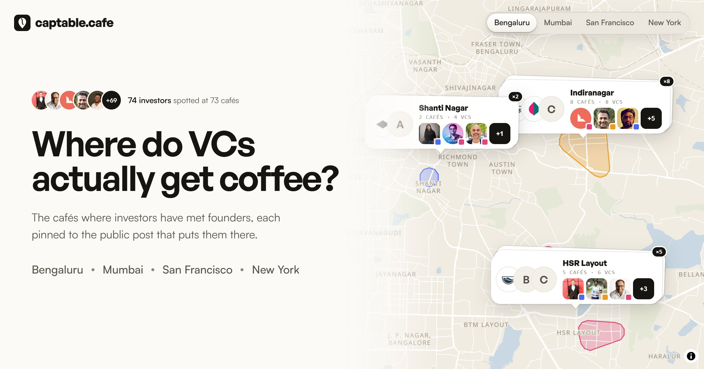

# captable.cafe

**A map of the cafés where VCs and angels meet founders, with every pin backed by a public post.**



Pick a city and the map shows the cafés where investors have been seen taking meetings. Open a
café to see who was there and the tweet or article that puts them there, word for word, with a
link to the original. Nothing is inferred or invented: no post, no pin.

Cities: **Bengaluru**, **Mumbai**, **San Francisco** (with Palo Alto and Menlo Park) and
**New York**. Idea from [meetvc.cafe](https://meetvc.cafe).

## Features

- **Cover and map.** Each city opens on a cover with the headline and the faces of the investors
  on record. Scrolling, dragging or "Explore the map" clears it.
- **Pins that carry the story.** Each café is a card with its logo, name and the faces of the
  investors seen there, each marked with the kind of cheque they write. Nearby cafés stack into a
  deck with a count, which fans out as you zoom in.
- **Neighbourhood zones.** Each neighbourhood with cafés is a tinted block with the streets running
  through it, coloured by the kind of investor seen there most: multi-stage funds, seed funds,
  angels or accelerators.
- **Side panel.** The full list grouped by neighbourhood, and a page per café with each investor
  set beside the post that puts them there, and the other cafés nearby. It sits on the right on wide screens and slides up
  from the bottom on phones.
- **Filter by investor type.** The map's legend doubles as a filter, and the list follows it.
- **Follow on X.** Follow everyone seen at one café, or across the whole city, in one go.
- **Shareable.** Every view has its own address (`/bengaluru/araku-indiranagar/`), and shared links
  unfurl with a preview image.
- **Found by search.** Each city, busy neighbourhood and café is built as its own page, with its
  own title, description, canonical link, structured data (schema.org) and first render, and all
  of them are listed in `sitemap.xml`.

## Quick start

Needs Node 20.19+ or 22.12+ (CI uses Node 24).

```bash
npm install
npm run dev        # http://127.0.0.1:5190
```

| Script            | Does                                                                                                |
| ----------------- | --------------------------------------------------------------------------------------------------- |
| `npm run dev`     | Vite dev server on port 5190                                                                        |
| `npm run build`   | Typecheck, build the static site into `dist/`, then write a page for every address in it            |
| `npm run preview` | Serve `dist/` on port 4173                                                                          |
| `npm run check`   | Typecheck, lint, formatting and unit tests; CI runs the same                                        |
| `npm test`        | Unit tests only (Vitest)                                                                            |
| `npm run format`  | Format with Prettier                                                                                |
| `npm run smoke`   | Drive the main flows in Chrome against the preview server                                           |
| `npm run og`      | Re-render the link-preview images (`public/og.jpg`, `public/og/<city>.jpg`) from the preview server |
| `npm run shot`    | Screenshot a URL: `npm run shot -- --url http://127.0.0.1:4173/mumbai/ --out shots/mumbai.png`      |

## Stack

Static site, no backend and no API keys: Vite, TypeScript (strict), Tailwind CSS 4, and MapLibre GL
on [OpenFreeMap](https://openfreemap.org) vector tiles with a custom warm basemap. Headings are set
in General Sans and text in Satoshi, both from [Fontshare](https://www.fontshare.com).

## Documentation

- [Architecture](docs/architecture.md): how the code is laid out, how state flows from the address
  bar to the map, and how markup stays safe.
- [Data](docs/data.md): the data model, what counts as a receipt, how cafés and cities are added,
  and the tools that find and verify them.
- [Contributing](CONTRIBUTING.md): the workflow, checks and commit style.

## Deploy

Vercel builds every push to `main` with the defaults it detects for Vite (`npm run build`, output
`dist`). Canonical links, the sitemap and preview images point at `site` in `src/config.ts`
(`https://captable.cafe`); set `SITE_URL` to build for another address. `vercel.json` adds the
trailing slash the built pages live under.

GitHub Actions runs `npm run check`, the build and the Chrome smoke test on every push and pull
request (`.github/workflows/ci.yml`).

## Credits

Map data © [OpenStreetMap](https://www.openstreetmap.org/copyright) contributors, tiles by
OpenFreeMap. Every quote belongs to its author and links to its source. Anyone listed can ask to be
removed through the issue form.

## License

[Apache 2.0](LICENSE).
